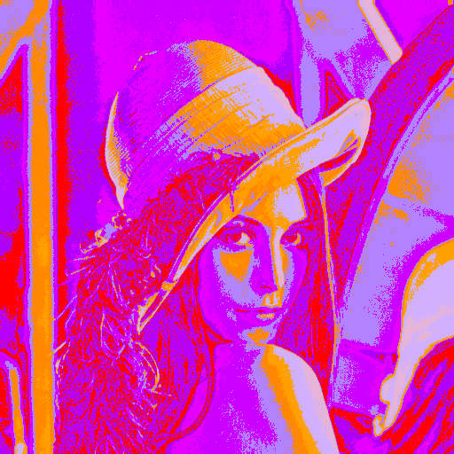
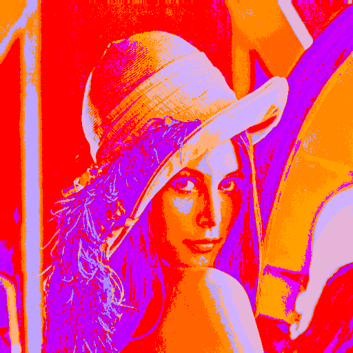

# Color Palette Changer

Color Palette Changer generates color palettes in OKlab space and maps those palettes onto input images.

The project has two main workflows:

- Generate a palette from a seed color or a random color, using configurable OKlab channel steps.
- Recolor an input image by mapping image regions or tones to colors from a palette JSON file.

## Overview

The palette generator creates a PNG preview and a matching JSON metadata file. The JSON file is the reusable palette definition used by the image mapping commands.

The mapper reads an input image and a palette JSON file, then produces a recolored output image. Two mapping modes are currently available:

- `grayscaled`: maps image brightness levels to palette colors.
- `oklab-clusters`: clusters input pixels in OKlab color space and maps clusters to palette colors.

## Setup

Install the Python dependencies:

```bash
pip install -r requirements.txt
```

## Generate a Palette

Generate a 16-color palette preview and JSON metadata:

```bash
python main.py --generate-palette -L -0.01 -a -0.0 -b 0.125 -p 16 -o palettes/test_3.png
```

This command writes:

- `palettes/test_3.png`: visual palette preview.
- `palettes/test_3.json`: palette metadata used by the mapper.

You can also provide a fixed seed color:

```bash
python main.py --generate-palette -c "#336699" -L 0.0 -a 0.1 -b 0.0 -p 10 -o palettes/blue_ramp.png
```

## Map an Image

Source images are stored in `inputs/`, including `lenna.png` and `witch_shelf.png`.
Relative `--input-image` paths are resolved inside `inputs/` in the current working directory;
provide the filename without the `inputs/` prefix. Absolute image paths are also supported.

Map an input image with brightness-based mapping:

```bash
python main.py --map --input-image lenna.png --palette palettes/test_3.json --image-mapping grayscaled
```

Map an input image with OKlab clustering:

```bash
python main.py --map --input-image lenna.png --palette palettes/test_3.json --image-mapping oklab-clusters
```

Write to a specific output path:

```bash
python main.py --map --input-image lenna.png --palette palettes/test_3.json --image-mapping oklab-clusters -o outputs/lenna_custom.png
```

Print extra details while generating or mapping:

```bash
python main.py --generate-palette -c "#336699" -p 8 -o palettes/example.png --verbose
```

## Command Reference

```text
python main.py (--generate-palette | --map) [options]
```

Palette generation options:

- `-c`, `--color`, `--colors`: seed color as `#RRGGBB`. If omitted, a random seed color is used.
- `-L`, `--lightness-step`: OKlab `L` channel step.
- `-a`, `--green-red-step`: OKlab `a` channel step.
- `-b`, `--blue-yellow-step`: OKlab `b` channel step.
- `-p`, `--palette-size`: number of colors to generate.
- `-o`, `--output`: output PNG path. A same-name JSON file is written beside it.

Image mapping options:

- `--input-image`: source image path relative to `inputs/`, or an absolute path.
- `--palette`: palette JSON file.
- `--image-mapping`: mapping strategy, either `grayscaled` or `oklab-clusters`.
- `-o`, `--output`: output image path. If omitted, the file is written under `outputs/`.

Shared option:

- `-v`, `--verbose`: print additional generation or mapping details.

## Visual Example

The following palette was generated with:

```bash
python main.py --generate-palette -L -0.01 -a -0.0 -b 0.125 -p 16 -o palettes/test_3.png
```

The generated example files are stored in `assets/`:

- `assets/palette_example.png`
- `assets/palette_example.json`
- `assets/lenna--test_3--grayscaled.png`
- `assets/lenna--test_3--oklab-clusters.png`

### Generated Palette


### Grayscaled Mapping

This output maps the source image's brightness values to the generated palette.



### OKlab Cluster Mapping

This output clusters the source image in OKlab space, then maps those clusters to the generated palette.


